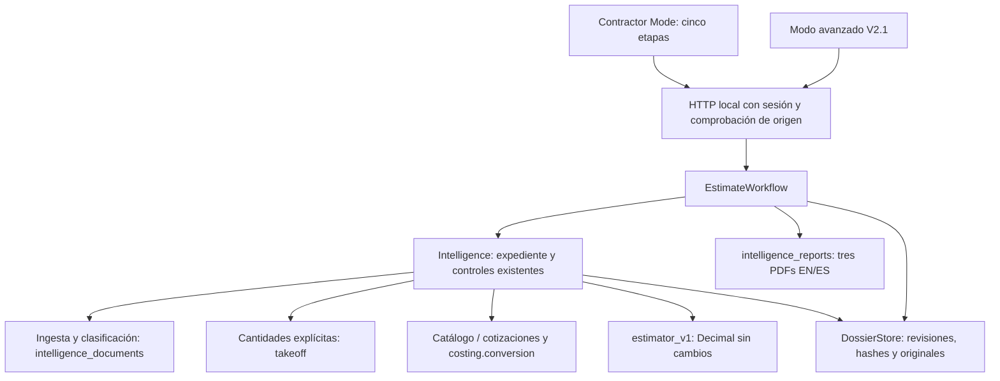

# ALKAN Bid Engine V3 — Contractor Guided Workflow

## Resultado

Contractor Mode está integrado en la aplicación existente y es la entrada
predeterminada. El contratista puede crear su proyecto, cargar documentos, analizar,
revisar cantidades y evidencia, registrar o comparar cotizaciones, calcular, aprobar
humanamente y descargar los tres documentos desde cinco etapas de una sola interfaz.
El enlace **Modo avanzado** conserva la interfaz V2.1 y abre el mismo expediente.

Se verificó el recorrido funcional con documentos sintéticos controlados y con un
PDF real local. El documento real solo permite borradores: no se inventaron costos
ni una aprobación comercial para completar la prueba. No se publicaron servicios,
no se usaron APIs pagadas y los conectores externos siguen apagados.

## Estado inicial y protección

- Carpeta original: `C:\Users\diana\OneDrive\Desktop\bidengine`.
- Se inspeccionaron src/bidkit, tests, reportes V2/V2.1, esquemas, UI, CLI y proyectos.
- Línea base ejecutada antes de editar: **106 pruebas y 7 subtests aprobados**.
- Sin repositorio Git; no se declaró una rama inexistente. No se modificó ALKANbid.
- Originales: **21 archivos de cuatro proyectos**, comprobados por SHA-256.
- Respaldo previo: `data/v3_audit/before_v3_code.zip`, **82 archivos**, hashes por
  archivo en `before_v3_manifest.json`; hash del ZIP en `baseline.json`.
- Manifiesto adicional de **432 archivos históricos** en proyectos, docs, output y
  ENTREGAS; la validación posterior comprueba que ninguno fue alterado.
- El plan anterior a los cambios está en `docs/ALKAN_BID_ENGINE_V3_PLAN.md`.

La auditoría confirmó que los motores de documentos, takeoff, precios, Decimal,
almacenamiento y exportación ya existían. Se añadieron coordinación y navegación;
no se reconstruyeron esos motores.

## Arquitectura



`EstimateWorkflow` coordina `Intelligence`; ambos usan el mismo `project_id`,
`DossierStore`, documentos, partidas, cotizaciones y resultados. El catálogo sigue
siendo la proyección de los expedientes existente en V2.1.

La información nueva reside en `state.workflow`: etapa actual, documentos ya
analizados, recibos de operaciones, referencia del cálculo y manifiesto de PDFs.
Cada transición guardada genera una revisión encadenada con responsable y fecha.
Las etapas y bloqueos se calculan desde el estado real del expediente; un indicador
de avance nunca sustituye la verificación de cantidades o precios.

Los metadatos de navegación quedan fuera de la huella comercial de aprobación.
Cambiar de pantalla o repetir un análisis sin cambios conserva la aprobación.
Cambiar evidencia, cantidades, condiciones o precios exige revisión de la versión
nueva. El precio contractual y las propuestas históricas continúan separados.

Idempotencia:

- Alta: identidad de solicitud estable, proyecto estable y detección de colisiones.
- Carga: hash de contenido y recibo persistente; reintentar no duplica originales.
- Análisis: candidatos existentes, incluidas identidades V2, conservan correcciones.
- Acciones: el mismo request_id y contenido se reconoce aun después de reiniciar;
  reutilizar el identificador para otro contenido se rechaza.
- Aprobación: reintentos con confirmación no agregan aprobaciones duplicadas.
- Catálogo: repetir la misma referencia para una partida no crea copias pendientes.
- Exportación: reutiliza artefactos íntegros de la misma base, idioma y estado;
  el conjunto de tres PDFs referencia una misma revisión de origen.

Las escrituras concurrentes conservan los controles de bloqueo y revisión esperada.
La interfaz rechaza guardados superpuestos y muestra una explicación. No se añadió
otra base de datos ni un motor de cálculo.

## Las cinco etapas

| Etapa | Experiencia y persistencia |
|---|---|
| 1. Proyecto y documentos | Clasificaciones independientes, carga múltiple y drag/drop; originales conservados; lista de archivos guardados |
| 2. Análisis y evidencia | Extracción y clasificación existentes, páginas y originales accesibles, revisión registrada en formulario; escaneados requieren revisión manual |
| 3. Partidas y cantidades | Edición de cantidad, categoría, especificación, fórmula y evidencia; conciliación de contradicciones; las fórmulas se muestran sin JSON |
| 4. Proveedores y costos | Catálogo/importación y formularios existentes, selección humana, comparación normalizada, flete, impuesto, vigencia, costos y margen; seguimiento especializado plegado |
| 5. Aprobación y documentos | Datos y condiciones comerciales, bloqueos comprensibles, confirmación humana, borradores permitidos y tres documentos finales cuando procede |

El progreso y la etapa actual se guardan en el expediente. La selección del último
proyecto se recuerda en el navegador; recargar o reiniciar el servidor recupera
la etapa y el estado desde disco. Modo avanzado recibe el mismo identificador de
proyecto al cambiar de vista. No se clonan formularios ni borradores independientes.

La generación final muestra enlaces explícitos a las tres descargas. No se envía
ningún archivo. Los documentos internos/proveedor pueden generarse antes como
borradores claramente rotulados; una propuesta comercial requiere aprobación
vigente y verificaciones completas. También se bloquea solicitar como final un
informe interno/proveedor si falta aprobación mediante la ruta del flujo.

## Archivos afectados y componentes reutilizados

Nuevos:

| Archivo | Función |
|---|---|
| src/bidkit/estimate_workflow.py | Orquestador persistente y proyección de progreso |
| src/bidkit/contractor_workflow.js | Cinco etapas, mismo DOM/formularios, progreso, recuperación y descargas |
| tests/test_estimate_workflow.py | Nueve pruebas de servicio e integración HTTP |
| tools/verify_contractor_v3_ui.cjs | Recorrido guiado real en navegador y reinicio del servidor |
| tools/verify_workflow_v3_real.py | PDF real local por el orquestador, aislado |
| tools/rollback_bid_engine_v3.py | Reversión verificable, simulación predeterminada |
| docs/ALKAN_BID_ENGINE_V3_PLAN.md | Plan y reversión previos a implementación |
| ALKAN_BID_ENGINE_V3_DELIVERY.md | Esta entrega |

Modificados:

| Archivo | Cambio |
|---|---|
| src/bidkit/intelligence.py | Excluir metadatos de navegación de la huella comercial; evitar doble aprobación; conservar aprobación sin cambios; firma de conciliación de alcance independiente de selección de precios |
| src/bidkit/intelligence_ui.py | Rutas de EstimateWorkflow y recurso JS; mismo servidor loopback |
| src/bidkit/intelligence_ui.html | Cargar la ampliación Contractor Mode |
| src/bidkit/intelligence_reports.py | Rotular borradores incompletos o sin aprobación |
| tools/verify_intelligence_ui.cjs | Ejecutar regresión de interfaz técnica con `?mode=advanced` |

El inventario exacto y los hashes posteriores están en
`data/v3_audit/release_manifest.json`. Los archivos históricos anteriores no se
modificaron para generar esta entrega.

Reutilizados sin cambiar sus motores: `intelligence_documents.py`, `takeoff.py`,
`price_catalog.py`, `costing.py`, `estimator_v1.py`, `intelligence_store.py`,
`estimate.py`, módulos de compliance/bids y el generador PDF existente. También
se conserva la ampliación `intelligence_ui.js` V2.1. Sin dependencias nuevas.

Decisión verificada: el recorrido detectó que la firma de conciliación incluía
`selected_quote_id`. Seleccionar un proveedor invalidaba una revisión de alcance
sin cambiar cantidades. Ahora esa firma considera documentos, cantidades,
especificaciones, fórmula y evidencia; un cambio físico sigue invalidándola.
Las firmas anteriores se reconocen cuando coinciden con el estado anterior.

## Resultados ejecutados

| Validación | Resultado / evidencia |
|---|---|
| Línea base V2.1 | 106 pruebas / 7 subtests, antes de editar |
| Suite completa V3 | **115 pruebas / 7 subtests aprobados**; pytest_results.xml y pytest_results.log |
| Regresión Decimal | Materiales 1025 + labor 400 = directo 1425; indirectos 142.50; total 1567.50; margen 20%; venta **1959.38** |
| Contractor Mode Chrome 156 | Alta, dos documentos, revisión, correcciones, cotizaciones versionadas, cálculo, bloqueos, borrador, aprobación y tres descargas |
| Persistencia | Recarga en cantidades y reinicio real del proceso servidor después de aprobar; mismo expediente, etapa y aprobación |
| Móvil/escritorio | 1440×1000 y 390×844; sin errores JS ni desbordamiento global |
| Modo avanzado | Regresión V2.1 completa con catálogo, CSV, costos reales, tres descargas y recarga |
| PDF real | Gonyea Invite to Bid, 1 página / 3155 caracteres; carga, análisis, guardado, reapertura y dos borradores; propuesta final bloqueada |
| Integridad | 21 originales y 432 archivos históricos comprobados contra hashes anteriores |
| Reversión | Simulación en carpeta activa y aplicación ensayada únicamente en copia aislada; historial sintético conservado |

Evidencias guardadas en `data/v3_audit/`:

- `guided_browser_results.json`: recorrido guiado y reinicio.
- `advanced/browser_results.json`: regresión de modo avanzado.
- `real_workflow_results.json`: PDF real, sin aprobación ni precios inventados.
- `historical_integrity_results.json`: archivos históricos sin cambios.
- `rollback_results.json`: ensayo aislado.
- `validation_summary.json`: resumen verificable.

Se inspeccionaron los PDFs descargados con pypdf: interno de dos páginas,
solicitud de proveedor de una y propuesta de una. Los dos últimos no contienen
proveedor de costos, total de costo interno ni campos de margen/indirectos.

## Demostración — datos sintéticos identificados

Origen: `anonymous_scope.txt` y `anonymous_quote.pdf`, creados solo para aceptación
en una carpeta temporal. No son precios de mercado ni un trabajo comercial real.

1. Carga: 10 EA de paneles y 8 HR de mano de obra; S1 como especificación sintética.
2. Análisis: dos partidas pendientes con documento/página y evidencia.
3. Revisión: confirmar cada partida; corregir 10 → 11 → 10 conservando historial.
4. Cotizaciones: material 100 por EA + 25 flete; labor 50 por HR sin flete. La
   actualización documentada de material a 105 se registra como otra cotización;
   el contratista la selecciona expresamente.
5. Cálculo: materiales 1050 + 25 = 1075; labor 400; directo **1475**; indirectos
   10% = **147.50**; contingencia 0; completo **1622.50**; margen 20% sobre venta;
   propuesto **2028.13**. Los porcentajes son entradas ficticias de la prueba.
6. Antes de completar condiciones: borrador de solicitud permitido, final bloqueado.
7. Revisión fiscal: supuesto explícito de impuesto cero **solo para QA**, sin
   presentarlo como regla fiscal de Washington.
8. Aprobación humana sintética y generación de tres PDFs de una misma revisión.
9. Reinicio del servidor: misma aprobación y etapa recuperadas desde disco.

Documentos de demostración:

- [Internal Cost Analysis](data/v3_audit/guided_internal_SYNTHETIC.pdf)
- [Supplier Material Request](data/v3_audit/guided_supplier_SYNTHETIC.pdf)
- [Formal Estimate / Bid Proposal](data/v3_audit/guided_proposal_SYNTHETIC.pdf)

## Capturas


## Matriz requisito → código → prueba

Las pruebas nuevas están en `tests/test_estimate_workflow.py`; se mantienen todas
las pruebas anteriores.

| Requisito | Código | Prueba ejecutada |
|---|---|---|
| Auditoría, línea base y originales | plan, ZIP, manifiestos; verify_workflow_v3_real | baseline.json; real_workflow_results; historical_integrity_results |
| Alta persistente, múltiples documentos y repetición | EstimateWorkflow.create/upload | create_multiple_uploads_analysis_and_retry_after_restart |
| Clasificación y takeoff existentes | execute(analyze), intelligence_documents/takeoff | synthetic_document_to_final_without_manual_engine_shortcuts; pruebas V2/V2.1 PDF, escaneado y contradicciones |
| Correcciones y cotizaciones inmutables | execute(line/quote), Intelligence | quantity_corrections_quotes_and_prior_versions_survive; recorrido guiado |
| Repetición de aprobaciones y navegación | recibos, basis, approve | financial_review_approval_bundle_and_navigation_idempotence |
| Firma de alcance independiente del precio | Intelligence.issue_signature/issues | quote_selection_preserves_scope_reconciliation_but_quantity_change_invalidates |
| Comparador y catálogo sin duplicados | attach_catalog, normalized_quote reutilizado | catalog_reference_retries_do_not_duplicate_and_current_basis_exports_only; regresión avanzada V2.1 |
| Cálculo reproducible Decimal V1 | execute(calculate), estimator_v1 sin cambios | synthetic_document_to_final_without_manual_engine_shortcuts; case_e_financial_regression; 12 tests V1 |
| Información insuficiente y escaneado | workflow_view, release_blockers | insufficient_evidence_drafts_and_final_blocks; PDF real y pruebas V2 |
| Transiciones, conflicto y solicitud diferente | execute y recibos | request_collision_conflict_and_transition_preconditions |
| Sesión local y HTTP | intelligence_ui routes/token/Host/Origin | persistent_http_operations_and_session_protection; tests HTTP V2 |
| Aprobación y tres PDFs EN/ES | workflow.export, intelligence_reports | financial_review_approval_bundle_and_navigation_idempotence; synthetic_document_to_final_without_manual_engine_shortcuts; three_exports_language_and_confidentiality |
| Borradores distinguibles | intelligence_reports.render_document | insufficient_evidence_drafts_and_final_blocks; recorrido guiado |
| Reapertura y reinicio real | mismo DossierStore y metadatos workflow | create_multiple_uploads_analysis_and_retry_after_restart; verify_contractor_v3_ui.cjs |
| Integridad histórica | manifiesto previo/posterior | 432 archivos y 21 originales; comparación SHA-256 |
| Escritorio y móvil | contractor_workflow.js y formularios reutilizados | verify_contractor_v3_ui.cjs; capturas y guided_browser_results |
| Interfaz técnica conservada | modo avanzado, mismo project_id | verify_intelligence_ui.cjs; cambio de modo en recorrido guiado |
| Documento real disponible | verify_workflow_v3_real.py | real_workflow_results.json; final bloqueado, dos borradores |
| Reversión sin pérdida de expediente | rollback_bid_engine_v3.py | rollback_results.json, ensayo aislado |

## Compatibilidad, límites y pendientes

No hay migración destructiva: el expediente conserva esquema 2.0 y añade un campo
opcional workflow. Un expediente anterior puede abrirse sin reescritura automática.
No se alteraron documentos, precios, analysis.json, entregas o aprobaciones históricas.

La aplicación es local. Conserva bloqueo de escritura y verificación de revisión;
no se ha validado como servicio multiusuario sincronizado por OneDrive. Si un proceso
se termina durante una escritura puede quedar `.write-lock`: verificar que no exista
otro escritor antes de recuperación manual. No elimina bloqueos automáticamente.

La extracción es la disponible en V2.1: PDF digital/TXT, imágenes para revisión
visual y CSV/XLSX con la plantilla. Sin OCR funcional, IA, lectura de escala ni
metrado geométrico automático. Un documento escaneado exige revisión manual.
Los precios PDF requieren transcripción y evidencia; no hay conector de proveedores.
No se recomienda ni calcula un margen por tipo de cliente. Los impuestos requieren
revisión contractual y jurisdiccional; no se deducen desde datos parcelarios.

Un cambio real de alcance o cantidades invalida conciliaciones previas. Las firmas
de revisión heredadas se reconocen mientras coincidan con sus datos; si cambian las
referencias, se requiere conciliación actual. No se migra una decisión por suposición.

La prueba real confirma ingesta y bloqueo correcto, no la exactitud de un presupuesto
comercial real. Los costos, impuestos y aprobación de la demostración son ficticios.
Para operar comercialmente se necesitan documentos legibles, cantidades verificadas,
precios vigentes con respaldo, identidad del contratista, tratamiento fiscal y
condiciones revisadas. No hay nuevas credenciales necesarias para el flujo local.

Estado: orquestador, Contractor Mode, regresión avanzada y tres entregables locales
**IMPLEMENTADOS**. OCR/IA, metrado geométrico, proveedores externos y parcelas en vivo
**PENDIENTES y DESACTIVADOS**; no son requisitos para el recorrido local validado.

## Comandos PowerShell

```powershell
Set-Location 'C:\Users\diana\OneDrive\Desktop\bidengine'
.\Start-BidEngine.ps1
```

Contratista: `http://127.0.0.1:8765/`; avanzado:
`http://127.0.0.1:8765/?mode=advanced`. Detener con Ctrl+C.

Alternativa con el intérprete disponible:

```powershell
$alkanPython = Join-Path $env:USERPROFILE '.cache\codex-runtimes\codex-primary-runtime\dependencies\python\python.exe'
& $alkanPython .\run_bidkit.py estimate-ui --root . --port 8765
```

Reproducción de pruebas en este entorno:

```powershell
$env:PYTHONPATH = "$PWD\src;$PWD\tmp\v2-test-deps"
& $alkanPython -m pytest -q
$alkanNode = Join-Path $env:USERPROFILE '.cache\codex-runtimes\codex-primary-runtime\dependencies\node\bin\node.exe'
& $alkanNode .\tools\verify_contractor_v3_ui.cjs
& $alkanPython .\tools\verify_workflow_v3_real.py
$env:ALKAN_AUDIT_DIR = "$PWD\data\v3_audit\advanced"
$env:ALKAN_V21 = '1'
& $alkanNode .\tools\verify_intelligence_ui.cjs
```

## Reversión

Detener el servidor y conservar el directorio completo antes de restaurar código.
Simular primero:

```powershell
& $alkanPython .\tools\rollback_bid_engine_v3.py
```

Verifica SHA-256 del respaldo y archivos, y bloquea la reversión si detecta trabajo
de código posterior. Después de revisar el listado:

```powershell
& $alkanPython .\tools\rollback_bid_engine_v3.py --apply
```

Primero archiva todo el código afectado; luego restaura V2.1. Conserva expedientes,
originales, revisiones y exportaciones. V2.1 no muestra metadatos workflow y puede
considerar una aprobación V3 pendiente de revisión por la huella anterior: no se
fuerzan aprobaciones a través de una reversión. El ensayo aplica la restauración
solo a una copia temporal; el código activo se conserva.
